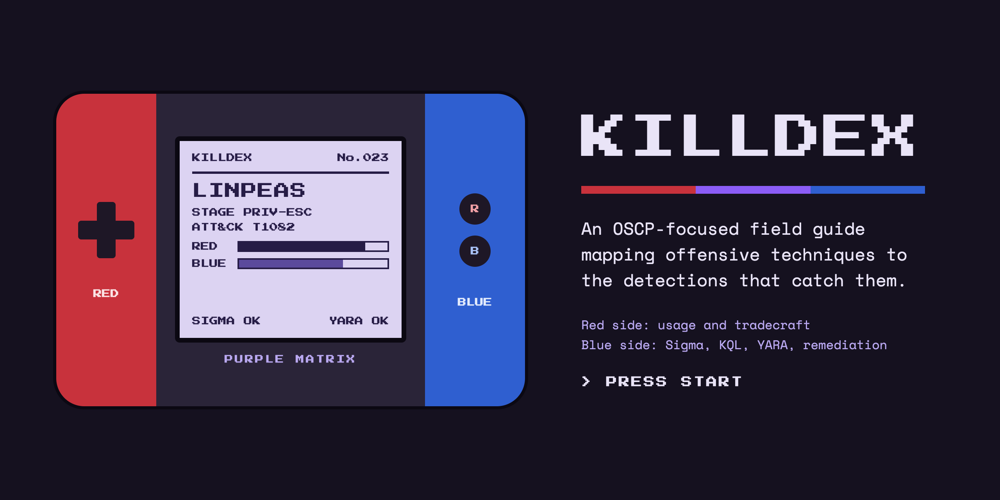

# Killdex

**An OSCP-focused field guide that maps offensive techniques to the detections that catch them.**

> 🚧 **Status: Egg.** This project is in the planning stage. Nothing has hatched yet.

<p align="center">
  
</p>

---

## What is Killdex?

Killdex is a command-line reference for purple teamers. Like a field index for creatures, every entry describes one technique or tool used in OSCP-style engagements and shows both sides of it:

- 🔴 **Red side:** what the technique does, how it's used, and what to look for in the output
- 🔵 **Blue side:** the telemetry it leaves behind, **Sigma** and **YARA** detections, known detection gaps, and remediation

Killdex is a reference only. It does not run any tools.

The goal is to connect the two halves of security: if you can perform a technique, you should be able to detect it.

## How it works

Entries are organized into four stages, following how an OSCP-style box is worked:

| Stage | What it covers |
|---|---|
| External Enumeration | Scanning and enumerating exposed services |
| Initial Access | Getting the first foothold |
| Internal Enumeration | Mapping the host once you're on it |
| Privilege Escalation | Going from user to root or SYSTEM |

```
$ killdex
? Choose a stage:
  > External Enumeration
    Initial Access
    Internal Enumeration
    Privilege Escalation
```

Pick a stage, pick an entry, and read both sides. Every entry is tagged with MITRE ATT&CK technique IDs.

## Entry format

Each entry is a YAML file, and detections live alongside them as real Sigma and YARA rules:

```yaml
id: linpeas
name: linPEAS
stage: privilege-escalation
platform: [linux]
attack: [T1082, T1083]
detections:
  sigma: [detections/sigma/linpeas_execution.yml]
  yara:  [detections/yara/linpeas_script.yar]
  gaps: "Fileless runs (curl | sh) evade the YARA rule; Sigma catches the behavior"
```

Not every technique can be caught both ways. When one doesn't apply, the entry says why. Knowing where detection falls short is part of the lesson.

## Evolution path (roadmap)

- [ ] **Stage 1:** Entry schema, loader, and one complete entry
- [ ] **Stage 2:** Interactive menus and rich terminal output
- [ ] **Stage 3:** `killdex show <id>` and `killdex search <term>` commands
- [ ] **Stage 4:** CI that validates every entry and compiles every Sigma and YARA rule
- [ ] **Stage 5:** Fill out all four stages for Linux and Windows hosts
- [ ] **Future:** Active Directory and lateral movement, ATT&CK Navigator coverage export

## Built with

Python · Typer · questionary · Rich · pydantic · PyYAML · pytest · sigma-cli · yara-python

## Responsible use

The techniques described here are for systems you own or are explicitly authorized to test, such as certification labs, CTF platforms, and personal labs. Entries cover techniques in general and do not include solutions for any specific lab machine or exam content.

## Disclaimer

Killdex is an independent project. It is not affiliated with or endorsed by OffSec, Nintendo, or The Pokémon Company. OSCP is a trademark of OffSec.
